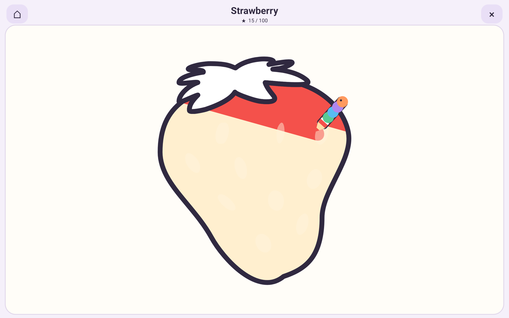
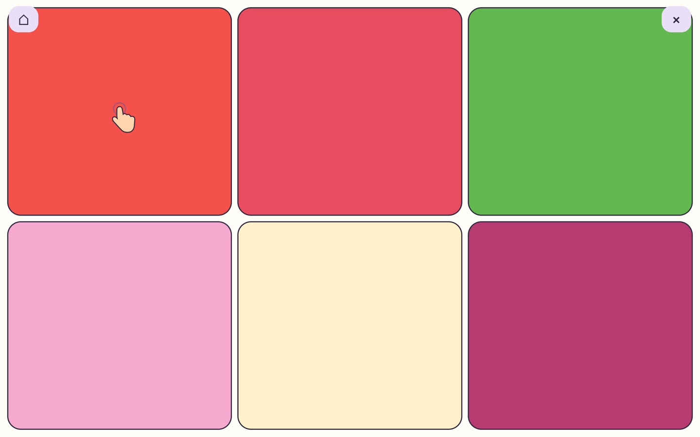
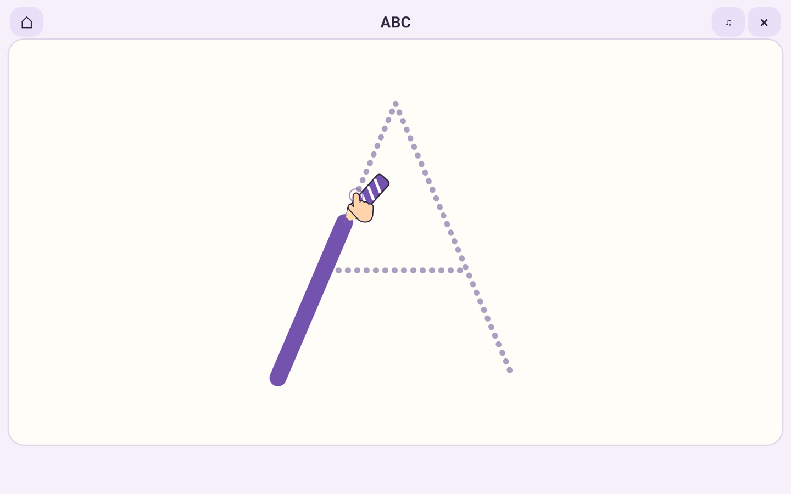
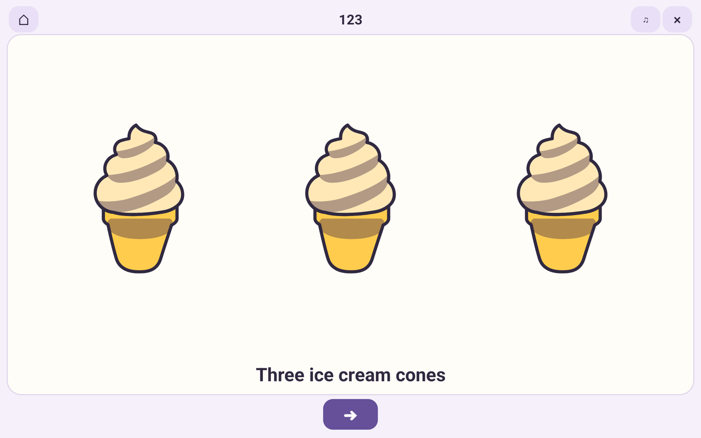

# Little Colors

An offline Android app for toddlers to color pictures, trace letters, and learn to count. A child can start by touching anywhere on the canvas, then move on to following the pencil or drawing freehand.

## Screenshots

| Coloring a strawberry | Picture-specific color picker |
| :---: | :---: |
|  |  |
| **Follow Along letter tracing** | **Counting reveal** |
|  |  |

## Play

- **Coloring** has 100 pictures, each with its own six-color palette. Hold to trace and fill in **Assisted**, move near the guide in **Follow Along**, or draw and erase in **Freehand**.
- **Learning** has uppercase **A–Z** and numbers **1–10**. Finishing a trace flips the card to a picture or a group to count. Tap the card to trace again or use the speaker button to repeat the narration. Each book remembers its last lesson.
- **Parent controls** include sound and music toggles. **Start play** requests Android screen pinning. Hold **Home** for two seconds to return to the Parent menu or **×** for five seconds to exit.

Artwork, narration, and sound effects are bundled in the app. Play works offline.

[Privacy policy](https://harshvishu.github.io/LittleColors/privacy/)

## Install with F-Droid

On Android, open the [Little Colors F-Droid repository](https://harshvishu.github.io/LittleColors/fdroid/repo/) and use the repository link or QR code to add it to the F-Droid app. Then search for Little Colors to install it and receive updates.

## Build and install

Use JDK 17 and the Android SDK with API 36 installed. Set `ANDROID_HOME` to your SDK directory or let Android Studio configure it. The app runs on Android 9 (API 28) and newer.

```sh
git clone https://github.com/harshvishu/LittleColors.git
cd LittleColors
./gradlew :app:assembleDebug :app:lintDebug
```

On Windows, use `gradlew.bat` in place of `./gradlew`.

Install the debug APK on a connected device or running emulator.

```sh
adb install app/build/outputs/apk/debug/app-debug.apk
```

Android requires the same signing key when installing over an existing copy.

## Contribute

- Use OpenSpec for app changes. Start with the [repository instructions](AGENTS.md) and review the [current specs](openspec/specs/).
- The [release guide](docs/releases.md) covers GitHub Actions artifacts, GitHub Releases, and the F-Droid feed.
- The native Kotlin UI and drawing engine live in [the Little Colors package](app/src/main/java/family/littlecolors).
- The coloring catalog uses [bundled vector paths and palettes](app/src/main/resources/artwork/pages.json). The [learning catalog](app/src/main/assets/learning/lessons.json) defines the stroke order and reveal for each lesson.
- Before opening a pull request, build and run lint, then try the affected flow in an emulator or on a device. For UI or touch issues, include the device, Android version, orientation, drawing mode, and steps to reproduce. [Report an issue](https://github.com/harshvishu/LittleColors/issues)

## License and credits

The application source and original project assets use the [PolyForm Noncommercial License 1.0.0](LICENSE.md). You may run, modify, and share Little Colors for permitted noncommercial purposes. Selling copies or using it in commercial projects requires separate permission. The license also describes permitted uses for certain organizations. [Copyright and third-party notices](NOTICE)

Adapted Twemoji graphics are licensed under CC BY 4.0. [Artwork credits](app/src/main/resources/artwork/CREDITS.txt) · [Graphics license](app/src/main/resources/artwork/LICENSE-GRAPHICS.txt)

Learning narration was generated with Piper using the LJSpeech voice. [Narration and dataset credits](app/src/main/assets/learning/CREDITS.txt)
